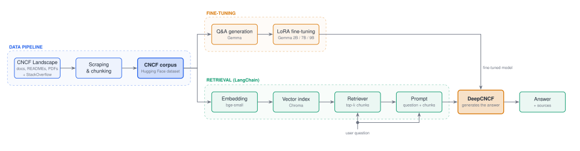

<div align="center">
  
  <p>Open-source LLM for simplifying and understanding the CNCF ecosystem.</p>
</div>

[](https://opensource.org/licenses/MIT)


## 📖 About 

Deep Cloud Native Computing Foundation, or DeepCNCF for short, is an open-source LLM aimed to simplify the Cloud Native ecosystem by resolving information overload and fragmentation within the CNCF landscape. The aim is to effortlessly provide users with detailed, context-related answers to any CNCF project.

It was developed as part of the [AMOS project](https://github.com/amosproj). Our industry partner is [Kubermatic](https://github.com/kubermatic). The project consists of a pipeline to gather necessary information (including documentation, pdfs, yaml files, jsons, readmes, and corresponding StackOverflow question/answer pairs) about [CNCF Landscape](https://landscape.cncf.io/) projects, create a question/answer pair dataset from the collected data using [Google Gemma](https://huggingface.co/google/gemma-2b-it), merge it with gathered StackOverflow question/answer pairs, and finetune the [Google Gemma 2B IT model](https://huggingface.co/google/gemma-2b-it), [Google Gemma 7B IT model](https://huggingface.co/google/gemma-7b-it), and [Google Gemma-2 9B IT](https://huggingface.co/google/gemma-2-9b-it) using the gathered data.

At answer time, DeepCNCF uses **Retrieval-Augmented Generation (RAG)** built with [LangChain](https://www.langchain.com/). The passages of the collected corpus that are most relevant to a question are retrieved from a vector index and passed to the model together with the question. Answers are therefore grounded in the actual project documentation and cite the files they are based on, and the knowledge base can be updated by re-indexing instead of retraining.

## 🏗️ Architecture

<div align="center">
  
</div>

1. **Data pipeline**: scrapes the CNCF Landscape projects and StackOverflow, cleans the data and splits it into chunks. The result is published as a Hugging Face dataset.
2. **Fine-tuning**: generates question/answer pairs from the corpus and fine-tunes Gemma with LoRA. The result is the DeepCNCF model.
3. **Retrieval-augmented generation**: embeds the same corpus into a vector index. For each user question, the most relevant chunks are retrieved, and DeepCNCF answers from them with source references.

The diagram is drawn in TikZ. Its source is [Documentation/diagrams/architecture.tex](Documentation/diagrams/architecture.tex).

## 🚀 Features
- Full data gathering and processing pipeline

  - **[src/landscape_scraper](src/landscape_scraper)**

  - **[src/scripts/scraping](src/scripts/scraping)**

  - **[src/scripts/data_preparation](src/scripts/data_preparation)**

  - **[src/scripts/qa_generation](src/scripts/qa_generation)**

- Training pipeline in 

  - **[src/scripts/training](src/scripts/training)**

  - **[src/hpc_scripts](src/hpc_scripts)**

  - **[src/hpc_scripts/training](src/hpc_scripts/training)**

- Retrieval-augmented question answering with LangChain in **[src/rag](src/rag)**

  - Local vector index (Chroma + `bge-small` embeddings), which can be built per project or for the whole corpus
  - Answers with source citations, served through any OpenAI-compatible endpoint (Ollama, LocalAI)
  - Runs entirely on CPU, with no GPU or cluster required
  - Benchmark evaluation of the model with and without retrieval

## 📊 Datasets

- **[cncf-raw-data-for-llm-training](https://huggingface.co/datasets/Kubermatic/cncf-raw-data-for-llm-training)**: raw scraped pdf, readme, json, documentation and yaml data. This is also the knowledge base for retrieval.
- **[cncf-question-and-answer-dataset-for-llm-training](https://huggingface.co/datasets/Kubermatic/cncf-question-and-answer-dataset-for-llm-training)**: artificial question/answer pair dataset generated from the raw data using [Google Gemma](https://huggingface.co/google/gemma-2b-it)
- **[stackoverflow_QAs](https://huggingface.co/datasets/Kubermatic/stackoverflow_QAs)**: real question/answer pair dataset gathered from StackOverflow. Only a subset of the questions with the highest rated numbers are included.
- **[Merged_QAs](https://huggingface.co/datasets/Kubermatic/Merged_QAs)**: merged artificial and real question/answer pair dataset
- **[Benchmark-Questions](https://huggingface.co/datasets/Kubermatic/Benchmark-Questions)**: multiple choice question/answer pair dataset used to benchmark the finetuned model, with and without retrieval.

## 🤖 Models

- **[DeepCNCF](https://huggingface.co/Kubermatic/DeepCNCF)**: initial model trained on [Google Gemma 2B IT model](https://huggingface.co/google/gemma-2b-it)
- **[DeepCNCFQuantized](https://huggingface.co/Kubermatic/DeepCNCFQuantized)**: quantized (GGUF, Q4_K_M) model based on [Google Gemma 1.1 7B IT](https://huggingface.co/google/gemma-1.1-7b-it), used for local CPU deployment and as the generator in the RAG pipeline
- **[DeepCNCF2BAdapter](https://huggingface.co/Kubermatic/DeepCNCF2BAdapter)**: finetuned [Google Gemma 2B IT model](https://huggingface.co/google/gemma-2b-it), trained on whole dataset
- **[DeepCNCF7BAdapter](https://huggingface.co/Kubermatic/DeepCNCF7BAdapter)**: finetuned [Google Gemma 7B IT model](https://huggingface.co/google/gemma-7b-it), trained on whole dataset
- **[DeepCNCF9BAdapter](https://huggingface.co/Kubermatic/DeepCNCF9BAdapter)**: finetuned [Google Gemma-2 9B IT model](https://huggingface.co/google/gemma-2-9b-it), trained on whole dataset
- **[bge-small-en-v1.5](https://huggingface.co/BAAI/bge-small-en-v1.5)**: embedding model used for the retrieval index

## 📁 Folder Structure

- **[Deliverables](Deliverables)** Contains all AMOS specific homeworks referenced with the sprint number they were due to.
- **[Documentation](Documentation)** Contains the documentation on how to run the project
  - **[Documentation/diagrams](Documentation/diagrams)** Contains the architecture diagram (TikZ source and rendered SVG).
- **[src](src)** Contains all the sourcecode of the project.
  - **[src/hpc_scripts](src/hpc_scripts)** Contains scripts that were specifically tailored to run on the HPC ([High Performance Cluster](https://hpc.fau.de/)) of the FAU. This is mostly for interacting with LLM's
  - **[src/scripts](src/scripts)** Contains all general purpose scripts (i.e. scraping data from CNCF Landscape and Stackoverflow, data formatting, deploying the model)
  - **[src/landscape_scraper](src/landscape_scraper)** Contains scripts for scraping the webpages of the CNCF landscape.
  - **[src/rag](src/rag)** Contains the LangChain retrieval-augmented generation pipeline (indexing, retrieval, chat and evaluation).
- **[test](test)** Contains all unit tests and integration tests.

## 🤔 Getting Started

If you want to run the data gathering and training pipelines yourself or if you want to use them to gather your own data, follow the steps provided in the **[Documentation](Documentation)**

To ask DeepCNCF questions with retrieval on your own machine:

```bash
python -m venv .venv-rag
.venv-rag/bin/pip install torch --index-url https://download.pytorch.org/whl/cpu   # Windows: .venv-rag\Scripts\pip
.venv-rag/bin/pip install -r src/rag/requirements-rag.txt

.venv-rag/bin/python src/rag/build_index.py --projects cilium istio envoy   # build a vector index
.venv-rag/bin/python src/rag/chat_cli.py                                  # chat (needs a running model server)
```

Serving the model, evaluation and all options are described in **[src/rag/README.md](src/rag/README.md)**.

Additional information can be found in the **[Wiki](../../wiki)**
